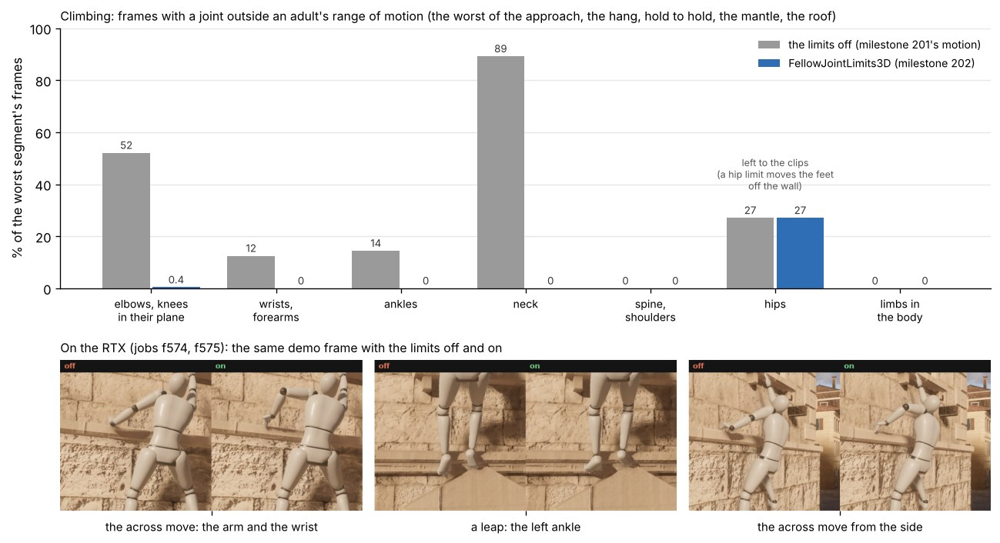

# FellowEngine — milestone 202 report (the joints within a person's range of motion)

Status: **FINAL** (2026-11-25). Branch `fellow/geometry`. GPU: the RTX filmed the demo's climb with the limits and
without, from the side and from behind (jobs f574, f575). Decision 0344.

## 0. Result

The owner, after milestone 201: "assess the movements' anatomical correctness, run a quality loop and deliver something
extra".

* **Assessed**: `tools/anatomy.gd` reads every joint of the drawn pose against an adult's active range of motion (the
  spine, the neck, the shoulders, the elbows and knees — their flexion and their bend to the side, which a hinge does
  not have —, the forearms' turn, the wrists, the hips, the ankles, the limbs through the body). `anim_quality.py`
  gives each segment's share of frames out of range, its worst moment, and seven new gates. Milestone 201's climbing:
  hanging's knees and elbows bent sideways in **52 %** of its frames, from hold to hold **26 %** (elbows up to 82°);
  the head tipped back past its range on **89 %** of the roof; ankles 14 %, wrists 12.5 % (one bent back 169° in the
  across move).
* **Fixed** (`FellowJointLimits3D`, a skeleton modifier last after the IK): the hinges turned into their bend's plane,
  the wrists, ankles and neck kept within their range, each correction eased. Climbing: hinges **0.4 %**, wrists,
  ankles, neck **0 %**; the gaits (but the hips) 4.8 → **0 %**; gates **33 → 38 / 45**.
* **Left**: the hips (the hang's catch spreads a leg 58°, the crawl flexes to 151°, the gaits' push-off extends past
  30°) — the clips' own; a hip limit would take the feet off the wall.

## 1. Measurements (headless; the demo at 120 fps, `anim_quality.py`)

| | the limits off | milestone 202 |
|---|---|---|
| climbing: elbows and knees out of their plane (the worst segment) | 52.1 % | **0.4 %** |
| climbing: wrists; ankles; neck | 12.5 %; 14.4 %; 89.2 % | **0 %; 0 %; 0 %** |
| climbing: spine and shoulders; limbs in the body | 0 %; 0 % | 0 %; 0 % |
| the gaits: every joint but the hips | 4.8 % | **0 %** |
| the hips: hanging; the mantle; the roof; the gaits' starts | 27.1 %; 8.0 %; 7.3 %; up to 17.5 % | the same |
| `anim_quality.py` gates | 33 / 45 | **38 / 45** |
| the fastest joint, hanging; from hold to hold (gate 2,200 °/s) | 959; 2,000 °/s | 1,004; 2,026 °/s |
| settled held hands' fingers off the edge; no held hand's on it | 0.2 %; 0.0 % | 1.1 %; 1.2 % |
| limbs through walls, from hold to hold | 0.7 % | 1.0 % |
| the modifier: the largest corrections over the demo; its time | — | hinges 83°, wrists 80°, ankles 22°, neck 13°; 7 µs a frame (a debug build) |

The jump at a wall is unchanged. `climb_check.gd` and `traversal_check.gd` have no failures. 2 of 37 and 4 of 19 lanes
differ slightly from milestone 201's, because registering a class shifts the instance IDs that stagger the traversal's
checks. With the class unregistered, every lane is identical.

## 2. The loop

| step | change | gates | what it showed |
|---|---|---|---|
| 0 | the anatomy measured, milestone 201's motion | 33/45 | the knees and elbows bent sideways (the IK places them, the arm's and thigh's turn the clip's), the head on the roof, the ankles in the leaps, a wrist in the across move |
| 1-3 | the measure checked (bends by `asin`, arms overhead, the hip's limit 140°, 0.5° slack) | 33/45 | false readings gone |
| 4-6 | `FellowJointLimits3D` | 38/45 | the wrists' first clamp flipped a hand (20,272 °/s); hinges turned at once snapped (4,014 °/s) |
| 7-9 | corrections eased per bone, held near straight | 38/45 | pops ≤ 2,026 °/s |
| 10 | the wrist turned about the knuckles | 38/45 | held hands off the edge 1.8 → 1.1 % |
| 11 | the wrists before the hinges | 38/45 | elbows out of plane 1.4 → 0.4 % |

## 3. Extra

An interactive anatomy report (an artifact): each joint's measured range against a person's, per segment, the limits
off and on; the worst moments with the RTX's frames; the before/after films.

## 4. Open

* The hips (above).
* The across move's trailing hand lifts its fingers for four frames (held hands off the edge 0.2 → 1.1 %).
* The mannequin's limbs are smooth cylinders: the hinges' turn shows at the joints' rings and in the hands and feet; a
  skinned character (a kneecap, an elbow's point) would show it more.
