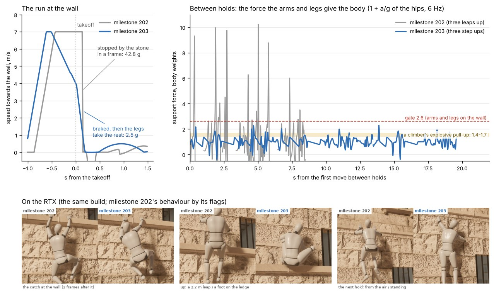

# FellowEngine — milestone 203 report (climbing within a person's strength)

Status: **FINAL** (2026-11-25). Branch `fellow/geometry`. GPU: the RTX filmed the demo's jump at the wall and its first
hold before and after, from behind and from the side (jobs f576, f577: "before" is the same build with milestone 203's
behaviour switched off by its tool flags, which reproduce milestone 202's measurements). Decision 0345.

## 0. Result

The owner, after milestone 202: "why does the character jump face first into the wall, and why is its push up so
effortless for it — assess the forces needed for the jump and make the animation realistic"; asked how to reach a hold
2 m up, the owner chose standing up onto the ledge below it.

* **Why the face hit the wall**: the run reached the wall at a sprint — 7.0 m/s at the takeoff, 1.1 m from it — and the
  stone stopped the body in a frame: **42.8 g**. The face came to 7 cm of the stone, the knees into it.
* **Why the push looked effortless**: the pose held the hips while the body rose and then let them go — up to **10.2
  body weights** (17 unfiltered), changes of speed of 8.5 g in 50 ms; a leap up rose **2.2 m** off a 4.3 m/s push and
  floated (decelerating at 0.66 g, not 1): under gravity 4.3 m/s carries a body 0.94 m; 2.2 m needs 6.6 m/s, twice a
  standing jump's take-off, from the arms. A reach's hand took the hold first and yanked the body up to it at 5.8 m/s.
* **The forces a person has** (`tools/effort.py`'s gates): a climber's explosive pull-up peaks at 1.4-1.7 body weights
  (PeerJ 11:e15886), arms and legs on the wall together about 2.5; a countermovement jump leaves the ground at 2.8-3.4
  m/s; a body stopped by its legs takes a few g.
* **Changed**: the run braked for the wall (4.0 m/s at the takeoff, 0.95 m from it) and steered in the air to where it
  will hang: **2.5 g**, the face **0.29 m** from the stone. A leap's push a half sine to **2.3 body weights**
  (`leap_push_force`: about 1.2 m of rise); a hold higher than that is **stood up to** from the ledge below
  (`hang_step_up_height`: pulled up to the chest at the edge, pressed to straight arms with a foot on the top, stood up,
  reached up on the toes, hung) — the house's 2 m gaps. The body pulled up at **1 m/s** at most (`climb_pull_speed`);
  the pose's sway horizontal and its fit no faster than arms (`sway_vertical`, `fit_max_speed`). Between holds at most
  **2.3 body weights** (was 10.2), **1.1 m/s** (was 5.8), no change of speed over **1.2 g** (was 8.5). `effort.py`:
  **0 / 7 → 6 / 6** gates.
* **Left**: the step up's high step — the foot onto a top at the hips' height — is not yet within the joints' range
  (`anim_quality.py` 38 → 35 / 45: a thigh's pop, a knee bent backwards, the toes and shin at the top's edge).

## 1. Measurements (headless; the demo from the house at 60 fps, `effort.py`)

| | milestone 202 | **milestone 203** |
|---|---|---|
| the run at the takeoff; the body stopped against the wall | 7.0 m/s; 42.8 g | **4.0 m/s; 2.5 g** |
| the face, chest, knees from the stone at the closest | 0.07, 0.27, −0.01 m | **0.29, 0.49, 0.04 m** |
| support force at its peak, any move (6 Hz) | 10.2 body weights | **2.3** |
| the body's fastest climb between holds | 5.8 m/s | **1.1 m/s** (the step up), 0.9 (a reach) |
| the largest change of speed over 3 frames | 8.5 g | **1.2 g** |
| a leap's flight against gravity; its rise | 0.66 g; 2.4 m | no leap in the demo (≤1.2 m at 2.3 body weights) |
| the demo's first eight moves from hold to hold | 8.5 s | 19.6 s |
| `effort.py` gates | 0 / 7 | **6 / 6** |
| `anim_quality.py` gates (the climb 26 s) | 38 / 45 | 35 / 45 |
| from hold to hold: fastest joint; hinges; wrists; ankles; hips; limbs in the stone | 2,026 °/s; 0.4; 0; 0; —; 1.0 % | 2,661 °/s; 6.2; 7.0; 0.98; 11.5; 8.5 % |
| hanging, the mantle, the roof, the gaits | | as they were |

`climb_check.gd` (37 lanes) and `traversal_check.gd` (19) are identical to milestone 202's with the new properties at
their defaults (off).

## 2. The loop

| step | change | effort gates | `anim_quality` | what it showed |
|---|---|---|---|---|
| 0 | milestone 202's motion | 0/7 | 38/45 | the wall at 7 m/s and 42.8 g; hips let go at 10.2 body weights; leaps of 2.4 m floating |
| 1-4 | the run braked, the takeoff closer, the body steered in the air; `sway_vertical`, `fit_max_speed` | — | — | 2.5 g; the fit needs an acceleration limit as well as a speed limit |
| 5-8 | `leap_push_force`, `climb_pull_speed` | — | — | the house's 2 m gaps beyond a person's leap → the owner chose a step up |
| 9-20 | `TRANSFER_STEP_UP`: in over the top, standing straight, hinges turned 175°, the elbows' and knees' poles | 6/6 | 34/45 | forearms through the wall 153 → 5-14 frames; the neck 11.8 → 0 % |
| 21-24 | the feet's balls on the top; the press only to straight arms, the grip eased off; the knee's pole eased off | 6/6 | 35/45 | the press had held the hips 0.7 s and let them go at 2.1 m/s (2.8 body weights) |

## 3. Open

* The step up's high step: a leg re-solve that plans the thigh's turn and the knee's way within the hip's range, the
  toes kept off the top's edge as the foot goes round it — with gates for its pop, hinges and wrists.
* `effort.py` takes the hips for the centre of mass; a mass-weighted centre from the limbs would read the arms' and legs'
  own swing.
* The RTX films show the mannequin; a skinned character would show the hips' and knees' faults more.

Sources: [PeerJ 11:e15886 (climbers' explosive pull-ups)](https://peerj.com/articles/15886).
