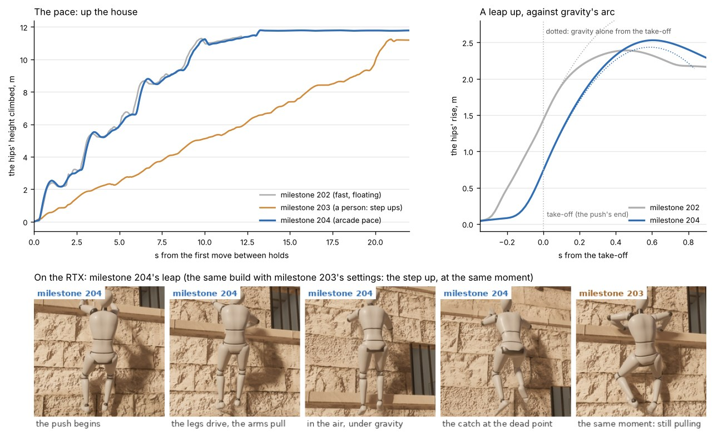

# FellowEngine — milestone 204 report (arcade pace, a person's motion)

Status: **FINAL** (2026-11-25). Branch `fellow/geometry`. GPU: the RTX filmed the demo's jump at the wall and first
holds, from behind and from the side, with milestone 204's settings and with milestone 203's on the same build (job
f579). Decision 0346.

## 0. Result

The owner, after milestone 203: "the joints bend unanatomically again; the climbing is now very slow — it is not about
100 % realism but arcade fun, with the animations relatively realistic".

* **Why it was slow**: milestone 203 stood up to the house's 2 m gaps at a person's strength — pulled up, pressed, a
  foot on the ledge, stood, reached: 4.4 s a gap; the reaches at 1 m/s. The demo's first eight moves took **19.6 s**
  (milestone 202: 8.5).
* **Why the joints bent**: that step up's high step folded the legs against the wall — a knee bent backwards, the hips
  past their range in 11.5 % of the frames, a thigh swung at 2,661 °/s, the toes and shins at the ledge's edge.
* **Changed**: the showcase leaps the gaps again — an arcade hero's dyno (`leap_push_force` 5.5) with a person's shape: a
  push from rest by the legs and arms, a flight under gravity, the catch at the dead point; reaches at 2 m/s; no step
  up. The leap's push is as long as its force needs (the body had been caught 9 cm short and lifted in a frame); from
  the push to the dead point the pose holds the hips off the body (the clip's crouch and rise had floated the flight at
  0.8 g: now **0.91-0.94 g**). A foot stepping up the wall stays under the body (ahead of it the leg had folded and the
  knee swung out sideways in a frame), its way in and out from the wall eased; the trailing hand across slower; the
  head tipped back 66° at most.
* **Pace**: the first eight moves **8.7 s** (19.6). The run at the wall stays braked (4.0 m/s, 2.5 g, the face 0.29 m
  from the stone).
* **Joints**: `anim_quality.py` **38 / 45** (milestone 203: 35; the seven left are the gaits' own, as before) —
  climbing's elbows and knees out of their plane **0 %** (6.2), wrists **0 %** (7.0), neck 0 %, the hips from hold to
  hold **0 %** (11.5), limbs in the stone **0.5 %** (8.5), the fastest joint **2,000 °/s** (2,661).
* `tools/effort.py --profile arcade` (a hero's strength; the gates that make motion read as real — braked at the wall,
  the face off it, a flight under gravity, no snap beyond the push — and the pace): **8 / 8** (milestone 202: 2 / 8,
  milestone 203: 6 / 7).

## 1. Measurements (headless; the demo from the house)

| | milestone 202 | milestone 203 | **milestone 204** |
|---|---|---|---|
| the demo's first eight moves from hold to hold | 8.5 s | 19.6 s | **8.7 s** |
| the run at the takeoff; stopped against the wall; the face from the stone | 7.0 m/s; 42.8 g; 0.07 m | 4.0; 2.5; 0.29 | 4.0; 2.5; 0.29 |
| a leap: the push's peak; take-off; flight against gravity; rise | 9.3 body weights; 4.3 m/s; 0.66 g; 2.4 m | — (step ups) | **5.2; 5.3-5.5 m/s; 0.91-0.94 g; 2.5 m** |
| between holds: the largest change of speed over 3 frames | 8.5 g | 1.2 g | 4.1 g (the push itself) |
| `effort.py --profile arcade` | 2 / 8 | 6 / 7 | **8 / 8** |
| `anim_quality.py` | 38 / 45 | 35 / 45 | **38 / 45** |
| climbing: hinges; wrists; ankles; neck | 0.4; 0; 0; 0 % | 6.2; 7.0; 0.98; 0 % | **0; 0; 0.1; 0 %** |
| from hold to hold: the fastest joint; the hips past range; limbs in the stone | 2,026 °/s; —; 1.0 % | 2,661; 11.5; 8.5 % | **2,000; 0; 0.5 %** |

`climb_check.gd` (37 lanes) and `traversal_check.gd` (19) are identical to milestone 202's.

## 2. The loop

| step | change | arcade gates | `anim_quality` | what it showed |
|---|---|---|---|---|
| 0 | milestone 203 | 6/7 | 35/45 | 19.6 s; the step up's joints |
| 1 | `leap_push_force` 5.5, `climb_pull_speed` 2, no step up | 7/8 | 36/45 | 8.6 s; flights at 0.77-0.81 g; a thigh's 2,318 °/s; the neck 4.2 % |
| 2 | the push long enough; the hips held off the body | 8/8 | — | flights 0.91-0.94 g; no catch lifted |
| 3 | a foot's way in and out eased | — | 36/45 | the knee still swung out: the foot was above the body |
| 4 | the feet under the body | — | 36/45 | hinges 0 %; a forearm's 2,268 °/s across |
| 5 | the trailing hand across slower; the neck to 66° | 8/8 | 38/45 | the fastest joint 2,000 °/s |

## 3. Open

* The step up (`hang_step_up_height`) stays in the engine for ledges beyond a leap, its high step not yet within the
  hips' range: off in the showcase.
* The mantle's and the roof crawl's hips (8 %, 7.3 %: the clips' own flexion), the gaits' seven gates: as before.
* A leap's flight reads 0.91-0.94 g, not 1: the capsule flies at g and the hips are held to it, but the 6 Hz filter
  rounds the push's end into the flight's first frames. A measure from the capsule's own phases would read it exactly.
