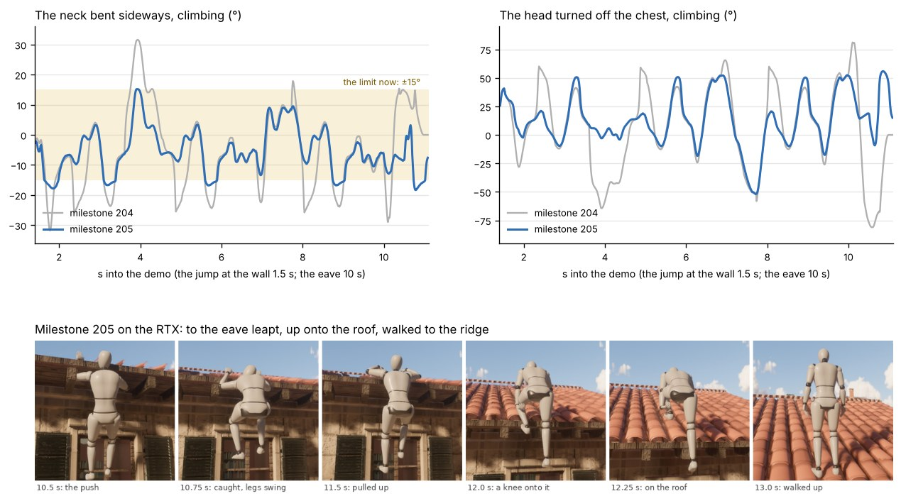

# FellowEngine — milestone 205 report (the leap to the eave, the climb onto the roof, the walk up it, the head)

Status: **FINAL** (2026-11-25). Branch `fellow/geometry`. GPU: the RTX filmed milestone 204's last moves onto the roof
(f580), milestone 205's first jump and the leap to the eave (f581) and its leap, climb and walk up the roof (f583).
Decision 0347.

## 0. Result

The owner, after milestone 204: "much nicer — only the first jump bends the head in a strange way, and I would fix the
last pull-up onto the roof"; then: "I meant the last jump onto the roof's outer edge, that is unnatural — and walking on
the roof needs improving too".

* **The head**: caught on the wall, the chest rolled 35° and the head, held upright, bent the neck 31° sideways; in the
  leaps the head looked straight up at the next hold and swung 40-60° from side to side. Now the look is no steeper than
  50°, turns into the wall as it steepens, is taken from the head itself and aimed at least 3 m out; the neck bends
  sideways 15° at most: **32 → 18°** at most climbing, the turn **81 → 56°**, its fastest **1,152 → 1,032 °/s**.
* **To the eave**: the lip stands 0.5 m out over the window's lintel; it was reached for, the body drifting up and out to
  it with nothing pushing it. Now it is **leapt to** — a short dyno up and out, the legs swinging under the lip.
* **Onto the roof**: the climb-up's clip ran 1.9 m in 1.24 s (the hips to 3.3 m/s, held and let go: −0.8 to 2.9 body
  weights), the feet braced on nothing under the eave, and the body set off up the roof at 1.5 m/s at once. Now **1.7 s**
  (the hips 2.5 m/s at most, −0.2 to 2.3 body weights), the feet on the wall under the eave, the walk on from rest.
* **Up the roof**: on hands and feet at 0.65 m/s (the hips past their range); now **walked** (the rooftops' 21° tiles;
  crawled only over 28°), leaning into the slope, easing in and out — to the ridge.
* `anim_quality.py` **38 / 45** (the mantle's limbs in the stone 4.7 → 0 %, its body jump 189 → 142 m/s², the roof's
  hips 1.8 → 0 %); `effort.py --profile arcade` **8 / 8** (the first eight moves 9.2 s: the eave is a leap now);
  `climb_check` / `traversal_check` identical.

## 1. Measurements (headless; the demo from the house)

| | milestone 204 | **milestone 205** |
|---|---|---|
| climbing: the neck bent sideways at most; turned at most; its fastest turn | 32°; 81°; 1,152 °/s | **18°; 56°; 1,032 °/s** |
| to the eave | reached for, 0.75 s | **leapt to**, 1.23 s (1.9 m/s off the push) |
| onto the roof: time; the hips' fastest; support force | 1.24 s; 3.3 m/s; −0.8 to 2.9 body weights | **1.7 s; 2.5 m/s; −0.2 to 2.3** |
| the mantle: body jump; limbs in the stone | 189 m/s²; 4.7 % | **142 m/s²; 0 %** |
| up the roof | on hands and feet, 0.65 m/s; hips past range 1.8 % | **walked**, 1.6 m/s; 0 % (toes on the tiles 2.4 %) |
| `anim_quality.py`; `effort.py --profile arcade` | 38 / 45; 8 / 8 | 38 / 45; 8 / 8 |

## 2. The loop

| step | change | `anim_quality` | what it showed |
|---|---|---|---|
| 0 | milestone 204 | 38/45 | the neck 32° sideways at the catch; the head swinging looking straight up; the eave reached for; onto the roof at 3.3 m/s |
| 1 | the look capped at 50°, turned into the wall | — | the leaps' swing gone; the catch's bend is the clip's roll (`--head_look=0`) |
| 2 | the neck's side bend 15°; the look from the head | — | 32 → 16° |
| 3 | the eave leapt to; the climb up paced, braced, left at its pace | 38/45 | the mantle's limbs in the stone 0 % |
| 4 | the roof walked up | 38/45 | the roof's hips 0 %; eased walks on roofs only (the gaits unchanged) |
| 5 | the look 3 m out | 38/45 | the head's fastest turn 2,568 → 1,032 °/s |

## 3. Open

* Over the eave the legs hang straight for a moment as the hips pass the edge (the mannequin's climb-up clip is keyed
  for a plain wall): a clip keyed for an eave, with a knee drive.
* The walk's toes catch the tiles' ridges (2.4 % of the roof's frames).
