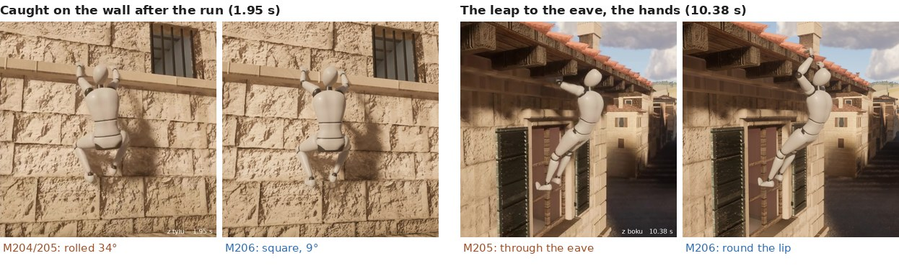

# FellowEngine — milestone 206 report (the hands round the eave's lip, the body square to the wall)

Status: **FINAL** (2026-11-25). Branch `fellow/geometry`. GPU: the RTX filmed the first jump at the wall and the leap to
the eave, from behind and from the side (jobs f584, f585). Decision 0348.

## 0. Result

The owner, after milestone 205: "the leap to the eave still isn't nice — the hands go through the roof and are suddenly
on the edge; and why is the torso twisted at the start, in the first jump at the wall? What is it for?"

* **The twist had no purpose: it was a fault.** The run's last stride turns the chest 37-42° from the hips, and
  Mixamo's "Run To Start Climbing" (the jump at a wall since milestone 197) keeps that turn and reaches with one arm.
  Caught on the edge by both hands, the body rolled 34° (the chest) and 25° (the hips). The showcase now jumps at a wall
  with the mannequin's own clip, both arms reaching and the chest square: **9° and 2°**. The arms' swing up out of the
  sprint is blended over 0.45 s (2,175 °/s, under the 2,200 gate).
* **The hands through the eave**: the lip is 0.24 m over the lintel's hold and 0.48 m out from it. The hands went up in
  a near-straight line from below, carried by the clip's arm reaching straight up, so the forearms went 6-15 cm into the
  eave's underside for 7 frames, then onto the lip at 8.2 m/s. Now they go **round the lip**: out first at the hold's
  height, up past its front, onto its top from above and outside. The move is eased from the push's start to the dead
  point, with the IK in charge from a third of the way. **No frame goes through the eave** (the hands' fastest is
  5.7 m/s, eased).
* `effort.py` measured a short leap's flight from the moment the hands let go, while the legs were still pushing: it
  read 0.57 g. The flight is now measured from the hips' fastest climb. Re-read this way, milestone 202's leaps braked
  in the air at 1.32-1.38 g rather than floating, and milestone 204's flew at 0.97-0.99 g.
* `anim_quality.py` **38 / 45**; `effort.py --profile arcade` **8 / 8**; `climb_check` / `traversal_check` identical.

## 1. Measurements (headless; the demo from the house)

| | milestone 205 | **milestone 206** |
|---|---|---|
| caught on the wall: the chest's roll; the hips' | 34°; 25° | **9°; 2°** |
| the run and the jump at the wall: the fastest joint | 2,037 °/s | 2,175 °/s (gate 2,200) |
| to the eave: frames with a forearm through it; depth | 7; 6-15 cm | **0** |
| to the eave: the hands' fastest | 8.2 m/s, onto the lip in a frame | 5.7 m/s, eased round it |
| the neck climbing: bent sideways; turned; fastest turn | 18°; 56°; 1,032 °/s | 18°; 56°; 912 °/s |
| `anim_quality.py`; `effort.py --profile arcade` | 38 / 45; 8 / 8 | 38 / 45; 8 / 8 |

## 2. The loop

| step | change | what it showed |
|---|---|---|
| 1 | `--mocap_keep=jump_wall` / `hang_catch` | the roll is Mixamo's jump at a wall's |
| 2 | the own jump at a wall, blended over 0.45 s | 9°, 2°; the arms 2,175 °/s |
| 3 | the hands round the lip on a quadratic | 1 frame through (5.8 cm) |
| 4 | a cubic, out first at the hold's height | none through |

## 3. Open

* At the leap to the eave the legs tuck under the lip at the catch; an arcade game might swing them out (a cut-loose).
* The jump at a wall is the mannequin's hand-keyed clip; a motion-captured one with both arms reaching would be better
  still.
