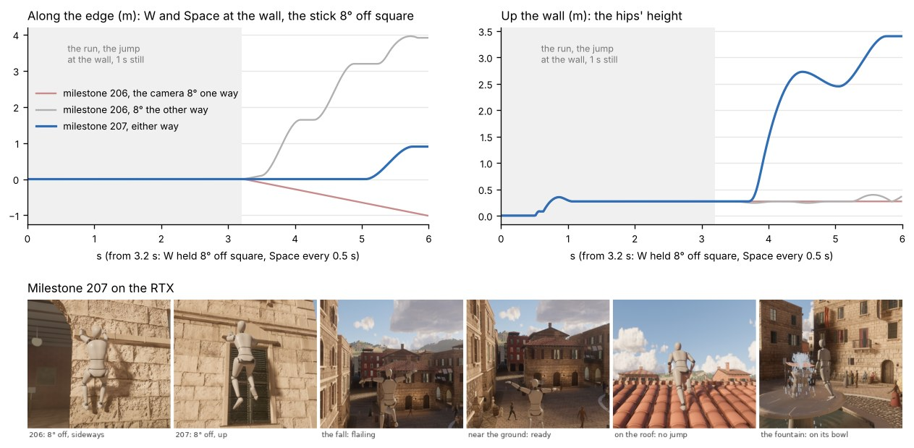

# FellowEngine — milestone 207 report (four faults found playing: the jump after the climb, the fall, the fountain, W at the wall)

Status: **FINAL** (2026-11-25). Branch `fellow/geometry`. GPU: the RTX filmed the climb with the stick off square, the
climb onto the roof and up it, the falls, the run at the fountain (jobs f586-f588). Decision 0349.

## 0. Result

The owner, playing after milestone 206: "after standing up on the roof the character does a strange jump; the fall has
a broken animation; the fountain in the middle has no collision box; climbing, when I hold W and press Space the
character sometimes goes along the edge, left or right at random."

* **The jump on the roof** was left over from the climb: Space pressed while hanging set the player's jump buffer,
  which is counted down only on the ground — the first frame on the roof, 1.7 s later, jumped the body. A press while
  the traversal has the body is now the traversal's alone.
* **Along the edge at random**: the traversal's intent is a speed (a run's 4.4 m/s) and the hang's thresholds are
  absolute, so with the camera only 7° off square to the wall, W read as along the edge: at 8° the body shimmied 1 m and
  never climbed, or leapt 4 m along the edge — which way depended on the camera. `hang_side_dead_zone` (the showcase
  0.5) takes a stick within 30° of square as straight in or up; a diagonal still goes along.
* **The fall** had the body upright and stiff in the air, the legs nearly straight, one arm out behind. It is now the
  body ready to land (the knees up, the arms out for balance, the eyes down), blending into a long fall's flail (the
  arms wheeling, the legs pedalling) from 0.45 to 1.1 s in the air and back as the ground comes up.
* **The fountain**: its column (2.7 m) and bowl (1.86 m) collide; a run at it climbs the rim, the bowl and the column.
* `anim_quality.py` **38 / 45**; `effort.py --profile arcade` **8 / 8**; the demo's path, `climb_check` and
  `traversal_check` identical.

## 1. Measurements (headless; `climb_look.gd --program=keys`: the stick at the wall, Space every 0.5 s while hanging)

| | milestone 206 | **milestone 207** |
|---|---|---|
| the camera 8° off (either way): along the edge; up to the eave | a 1.0 m shimmy, or a 4 m leap along it; never | **0** (the route's own move across); **yes** |
| 20° off; 45° (a diagonal) | 1.6 m, 4 m; along | 0; along (unchanged) |
| on the roof after the climb | a jump, 4.8 m/s up, 1.7 s after the press | **none** (with the sprint held too) |
| the fall off the roof (1.25 s): the knees after 0.7 s; the hands | 11-76°; 0.08 m under the shoulders at most | **51-83°**; up to **0.31 m over** them |
| the fall's fastest joint | 1,276 °/s (out of the run) | the same; 374 °/s in the flail |
| the fountain: rays down at 0 / 1.0 / 2.0 m from its middle | 0.75 m everywhere (the basin's octagon) | 2.7 / 1.86 / 0.75 m |
| `anim_quality.py`; `effort.py --profile arcade` | 38 / 45; 8 / 8 | 38 / 45; 8 / 8 |

## 2. The loop

| step | change | what it showed |
|---|---|---|
| 1 | `--program=keys`, the camera 0, ±8, ±20° off | the hang's thresholds read the run's speed: 7° off is along the edge |
| 2 | `hang_side_dead_zone` 0.5 (first 0.3 plus half the push, in the intent's units: reworked as a share of its length) | ±8, ±20° climb as square; 45, 90° still along |
| 3 | the jump buffer emptied while the traversal has the body | no jump on the roof |
| 4 | the fall rendered (lavapipe): upright, stiff | a new pair, `clip_fall` and `clip_fall_flail`, baked with the `bpy` module and put in the library by `tools/update_clips.gd` |
| 5 | `fall_mix`: by the time in the air, back near the ground | a jump's descent ready, a roof's fall flailing then ready |

## 3. Open

* The hang's other thresholds are still in the intent's units (a stick half pushed at the wall climbs at a run's speed
  as a full one does); the dead zone is the case the owner met.
* An 11 m fall ends in a roll at 4.4 m/s: an arcade's, not a person's.
* Next, as the owner asked: the people in the square bumped into and knocked over, not walked through; skirts as cloth;
  the hay on the cart.
