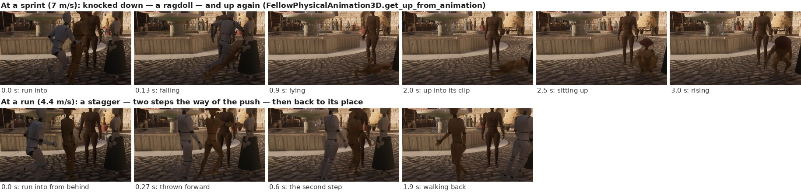

# FellowEngine — milestone 208 report (the square's people solid: run into, staggered, knocked down and up again)

Status: **FINAL** (2026-11-25). Branch `fellow/geometry`. GPU: the RTX filmed one of the square's people run into at a
sprint, a run and a walk (job f589). Decision 0350.

## 0. Result

The owner: "I'd like more interaction with the NPCs: to run into them, knock someone over, not to pass through them."

* **Solid**: the square's 46 people are capsules the player meets; its rays (the edge, the wall ahead, the ground) see
  the world alone, so a person ahead is no wall to jump at.
* **Run into**, by how fast the body met them: at a walk a shove (they give up to 0.35 m and stand back); at a run a
  stagger — two quick steps the way of the push, turned to it, the arms out (new clips "stagger_back",
  "stagger_fwd"); at a sprint, or landed on, **knocked down**: a ragdoll that falls, lies still, and gets up
  ("get_up_back" or "get_up_front", placed where the body lies and blended from it). Then a walker walks on back into
  its way; the others walk back to their place, waiting while the player stands in it. The player goes on slowed.
* **The engine**: `FellowPhysicalAnimation3D.get_up_from_animation(blend)` gets a ragdoll up into the game's own clip
  without a motion matcher; `knock_down()` reaches lying with `balance` off; a game rig's root bone on the ground gets
  no body (its capsule had pushed the hips up getting up: 10.5 → 4.4 m/s).
* The demo's path is unchanged with the people solid. `anim_quality.py` **38 / 45**, `effort.py --profile arcade`
  **8 / 8**, `balance_check` / `physical_check` / `climb_check` / `traversal_check` identical.

## 1. Measurements (headless, `climb_look.gd --program=bump`: one of three talking in the square's middle, from behind)

| | walk (1.6 m/s) | run (4.4 m/s) | sprint (7 m/s) |
|---|---|---|---|
| the person | shoved 0.1-0.35 m | a stagger forward, 0.55 m in 1 s | knocked down: falls 0.75 s, lies still, up 1.1 s later, standing in 2.0 s, talking again 5.5 s after the hit |
| the player on | stopped, leaning on them | 1.98 m/s | 4.9 m/s, through the group |

| getting up | with the root's body | **without** |
|---|---|---|
| the clip's first pose from the bodies (mean, by mass) | 0.40 m | 0.28 m |
| the bodies' fastest while blending (0.8 s) | 10.5 m/s | **4.4 m/s** |

## 2. The loop

| step | change | what it showed |
|---|---|---|
| 1 | capsules and `bump()` | knocked down, the body stayed "falling": the fall's states ran only with `balance` |
| 2 | the states on while not standing; `get_up_from_animation` | up, but the hips' body at 10.5 m/s |
| 3 | no body for a ground root | 4.4 m/s |
| 4 | Jolt Physics tried | the ragdoll stiller, the climb's trailing forearm past the gate: kept on Godot Physics |

## 3. Open

* The showcase stays on Godot Physics: under Jolt the climb's trailing forearm (already at the pose's 2,000 °/s cap,
  the elbow hinge's correction on top) reaches 2,471 °/s; a milestone of its own.
* A get-up from a side starts 0.28 m from the clip's first pose on average; a side's own clip would fit better.
* Next, as the owner asked: skirts as cloth; the hay on the cart.
