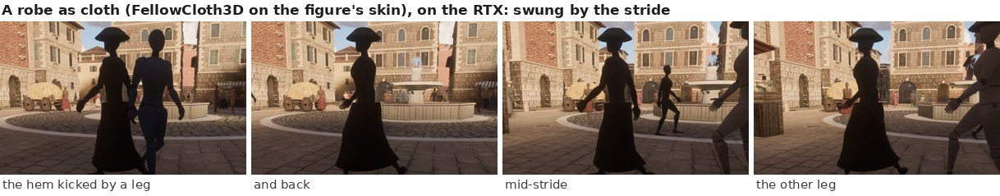

# FellowEngine — milestone 209 report (the square's robes as cloth)

Status: **FINAL** (2026-11-25). Branch `fellow/geometry`. GPU: the RTX filmed a walker in a robe and the group in the
square's middle run into (job f590). Decision 0351.

## 0. Result

The owner: "the skirts not as solids but as cloth with a simulated material."

* A long robe on the square's people is now `FellowCloth3D` on the figure's skin (no engine work: milestones 116 and
  147's garments): a flared tube from the waist to below the knees, its waistband pinned to the hips, the rest skinned
  towards the thighs and kept within 0.22 m of that, off the body by the backstop and out of capsules on the legs and
  hands. It swings with the stride (the hem kicked forward by a leg and falling back), with the wind, and with a
  knocked-down figure's ragdoll.
* The cost: 14 robes, 162 particles each, 240 substeps a second within 32 m of the camera. On the RTX laptop all of
  the town's cloth together (the robes, the banners, the awnings) takes 1.0 ms of the main thread a frame.
* The demo and the people's reactions are unchanged.

## 1. Open

* A hand's knuckles brush through the robe at the hip now and then (the hands' capsules are the palm's).
* Next, as the owner asked: the hay on the cart.
