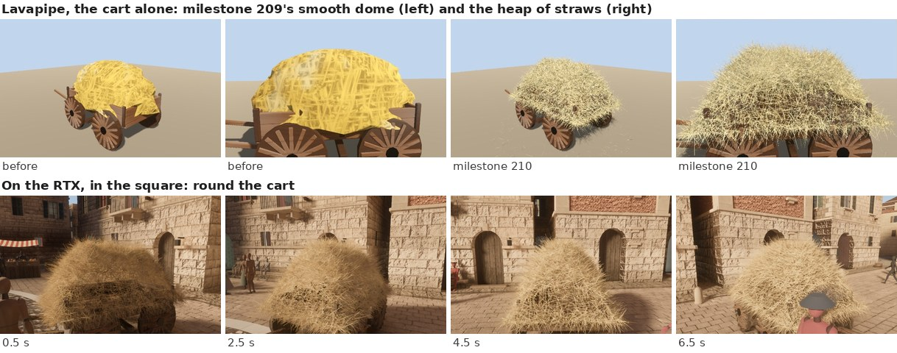

# FellowEngine — milestone 210 report (the cart's hay heaped and strawed)

Status: **FINAL** (2026-11-25). Branch `fellow/geometry`. GPU: the RTX filmed round the cart, the demo's leap of
faith into it and a walker's robe from its other side (jobs f591, f592). Decision 0352.

## 0. Result

The owner: "the hay pile on the cart looks very unrealistic and off-putting."

* The smooth yellow dome is gone. A node on the cart makes the hay at run time: a lumpy heap over the bed, higher than
  its sides and spilling over the boards, and 26,000 thin curved straws over it — most lying along it every way, some
  standing out, a fringe hanging down over the boards, a few fallen round the cart — each its own length, width, curl
  and colour (gold, pale, darker, a few grey-green and brown).
* The leap of faith landing in the hay throws straws up from where the body lands.
* The cart's collider, the demo and the leap are unchanged.

## 1. Open

* The straws do not move: the wind, or a body landing in them, could stir them (a vertex shader on the blades).
* The demo's camera on the landing in the hay is sometimes blocked by a passer-by walking through it (the people are
  solid since milestone 208 but walk where they always did).
