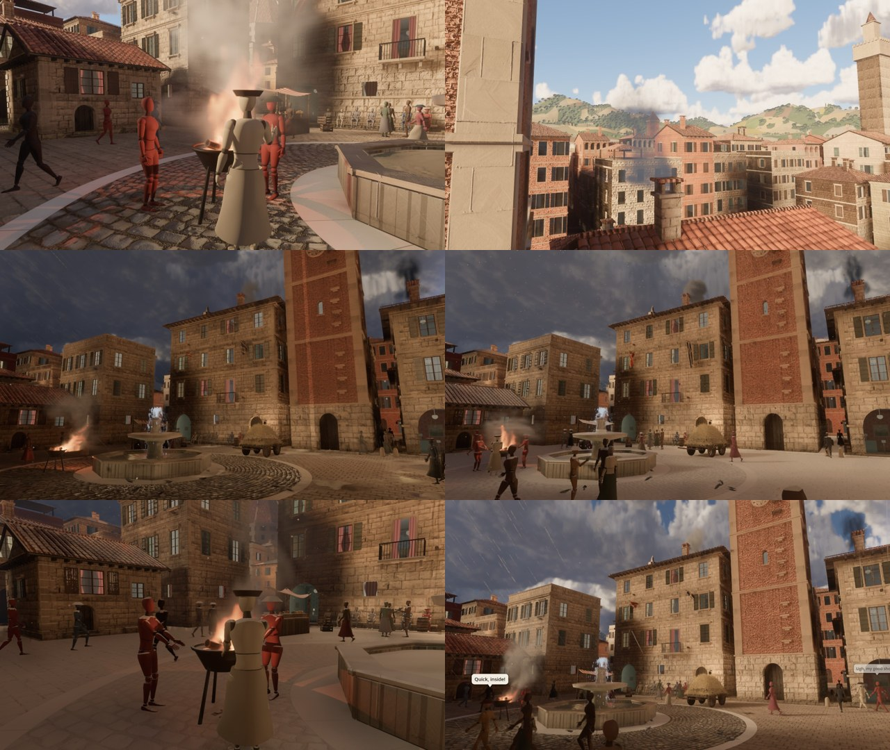

# FellowEngine — milestone 211 report (the square's weather on the keys, a brazier burning, the chimneys smoking)

Status: **FINAL** (2026-11-26). Branch `fellow/geometry`. GPU: the RTX filmed the brazier, the chimneys, a storm, snow,
a blizzard and the rain at the brazier (jobs f594, f596, f598-f602). Decision 0353.

## 0. Result

The owner: "can we also show fire, smoke and the weather in this showcase?"

* **The weather on the keys 1-7**: the scene's own golden-hour weather, cloudy, overcast, rain, a storm with
  lightning, snow, a blizzard — over 10 s — and 0 for the weather changing by itself (FellowWeather3D driving the wind,
  a FellowRain3D and a FellowLightning3D). The rain wets the stones and makes puddles, the snow whitens the square, the
  fog closes in (the scene's depth fog drawn in to the weather's visibility), the light greys (the sky's own sun
  dimmed with the weather), the lamps glow brighter as it darkens. A weather chosen at the start (`--weather=`)
  leaves the ground as it would have.
* **A brazier on the square**: an iron bowl on three legs, three logs burning in it — they char and glow — its flames
  lighting the square with shadows; it is solid; the rain or snow on it damps it (less fire, more smoke and steam); the
  wind leans its flames.
* **Smoke from three chimneys**, carried off by the wind.
* **Found on the RTX and fixed**: the logs had stayed cold (FellowBurnable3D looked for its gas volume under itself:
  it looks from its own middle now), the flames lay flat in a blizzard's wind (the gas's wind a fifth of the scene's,
  at most 2.5 m/s), the rain's streaks and the snow's flakes were not seen at 720p (wider streaks, larger flakes, more
  of them when it snows), a storm's light stayed golden (the sky's sun dimmed and greyed), the fog did not close in
  (FellowWeather3D draws an environment's depth fog in now), the chimneys' smoke had the whole sun under an overcast
  sky (the weather's sunlight on the smoke too) and was black in the bell tower's shade (a wood fire's pale smoke
  now: Fire Lab's grey soot scattered half the light).
* The demo's path is unchanged (it passes no nearer than 10 m from the brazier).

## 1. Open

* Under snow or a storm the square's light stayed a golden hour's: the clouds dim the sun, but the sky's light on the
  scene (its radiance map, which SDFGI takes) kept the clear sky's colour and shape — milestone 214.
