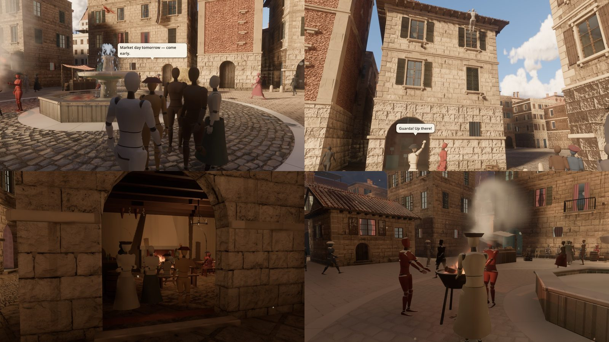

# FellowEngine — milestone 212 report (the square's people talk, look and point, leave in the rain, warm their hands)

Status: **FINAL** (2026-11-26). Branch `fellow/geometry`. GPU: the RTX filmed a talk, the people looking up at the
demo's climb and pointing, the square emptying in the rain, hands warmed at the brazier in the snow (jobs f595, f597).
Decision 0354.

## 0. Result

The owner: "and some interactions with the NPCs?"

* **E talks** to the person in front of the player: they stop, turn to the player, wave and talk; their lines appear
  in a speech bubble over their head — a greeting (or a reproach to the one who knocked them down), the player's
  climbing if they saw it, the weather, a word on the town — E for the next line, then a farewell, and they go back to
  what they were doing. "E  Talk" marks the one in reach.
* **They look at the player** (their heads turn): the ten nearest within 7 m — and everyone within 24 m while the player
  is up a wall or on a roof, one of them pointing up and shouting every 6 s ("Guarda! Up there!").
* **The weather**: in the rain the standing groups leave the square by the streets (milestone 213: or into the
  osteria) and come back when it stops; the walkers hurry; the stall keepers huddle under their awnings. Round the
  brazier three people warm their hands in the cold.
* **Run into**, they shout ("Ehi!", "Attento!"; getting up "Maleducato!").
* Four new clips made in Blender like the others: a wave, pointing up, warming the hands at a fire, huddling against
  the weather.
* The demo's path is unchanged.

## 1. Open

* The people sitting on the benches stay seated in the rain (no clip to stand up from a bench).
* A line at a time, no answers to choose.
