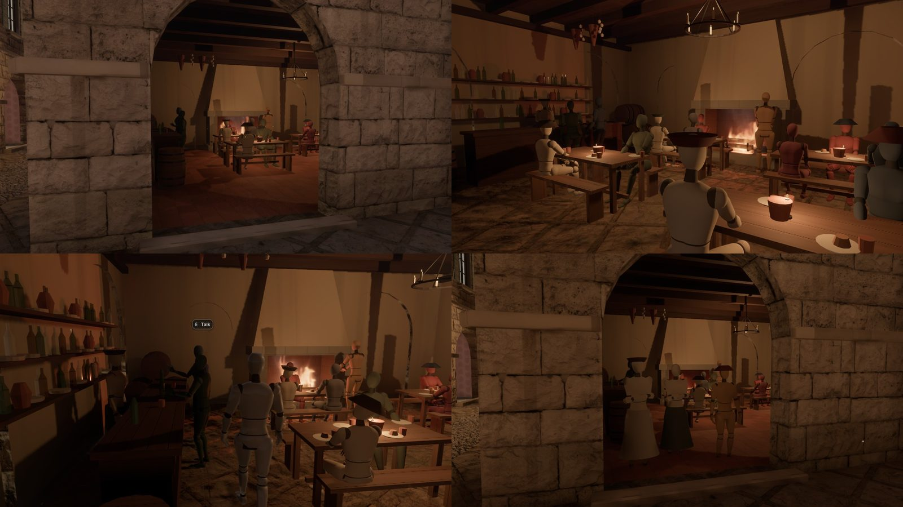

# FellowEngine — milestone 213 report (an osteria open to the square, its room furnished and peopled)

Status: **FINAL** (2026-11-26). Branch `fellow/geometry`. GPU: the RTX filmed it from the square through its arch,
inside, the player walking in, and the square's people coming in out of the rain (job f597). Decision 0355.

## 0. Result

The owner: "and maybe some open buildings with a real interior?"

* **CasaRosa's ground floor is an osteria**, open to the square through its two shop arches: walk in from the square.
* **The room** (9.5 by 8.4 m): a terracotta tiled floor, plastered walls on a stone skirting, a plank ceiling on beams;
  a stone fireplace with a hood and three logs burning in it (the town's fire and burning: they light the room and
  cast shadows); a counter with shelves of bottles and jugs, barrels on a rack; four tables with benches, jugs, cups of
  wine, plates with bread and a candle each (flickering); an iron chandelier of candles; hams and garlic from a beam.
* **Its people**: the host behind the counter, ten guests at the tables, two at the counter, one warming at the fire
  — they look at the player and talk (E) as the square's do.
* **In the rain** the square's people come in out of it and stand inside, and go back out when it stops.
* Made at run time from the building as it is (its shop glass taken out of a copy of its mesh, its solid ground floor's
  collider replaced by the room's walls); 26,000 triangles, 6 lights. The demo's path is unchanged.

## 1. Open

* The other buildings' doors stay closed.
* The arches are open shop fronts: no doors to open.
