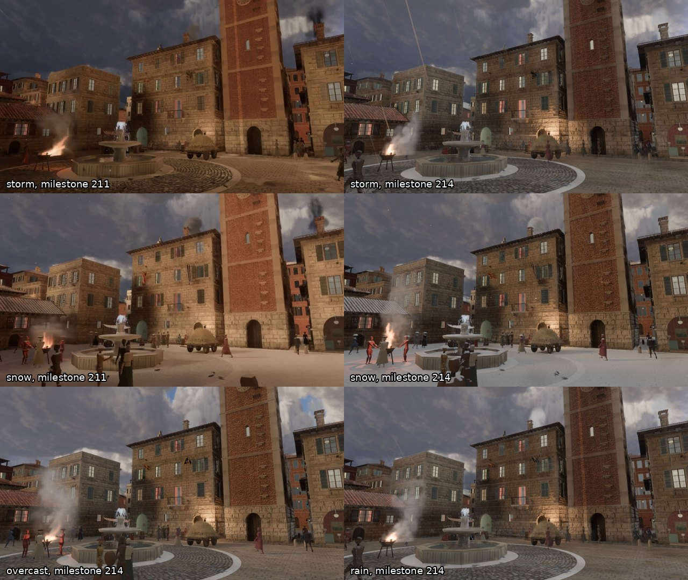

# FellowEngine — milestone 214 report (the overcast weather's light)

Status: **FINAL** (2026-11-26). Branch `fellow/geometry`. GPU: the RTX filmed the square in each weather before and
after (jobs f601-f609). Decision 0356.

## 0. Result

Milestone 211's weather keys left the square lit as on a fair evening under snow, rain or a storm: golden, the bell
tower's shadow sharp across the houses. The engine dimmed the sun on the surfaces but not everywhere it reaches the
picture:

* **SDFGI and VoxelGI take the weather's sunlight** (they lit the scene with the whole sun under any sky) and the
  atmosphere's colour of the sun, as the surfaces do. The atmosphere's aerial perspective takes the weather's sunlight
  too.
* **The sky's light turns overcast**: FellowEngine tells the sky's shader how overcast the sky is
  (`fellow_weather_overcast`, a shader global the project declares); the showcase's atmosphere sky turns its light on
  the scene — the ambient light, the reflections, SDFGI's sky — to an overcast sky's: grey, brightest overhead.
* **The rooftops**: the sky's light no longer dimmed with the clouds' own sun, less sun under a closed deck (no sharp
  shadow of the bell tower in a storm), and the eye adapts to the weather (the exposure raised as the weather darkens,
  the fair evening's as it was): an overcast sky a stop darker than the fair evening, a storm a stop and a quarter.

## 1. Open

* The visible sky under the clouds: the volumetric clouds over a snowy square are a storm's, dark grey (lit by the sky's
  own sun the weather keys dim for the clouds' sake).
* A sky shader that does not read `fellow_weather_overcast` keeps the clear sky's light (decision 0133's greying on the
  surfaces that take the radiance map themselves).
* The regression suite has no scene with SDFGI or VoxelGI under a weather.
