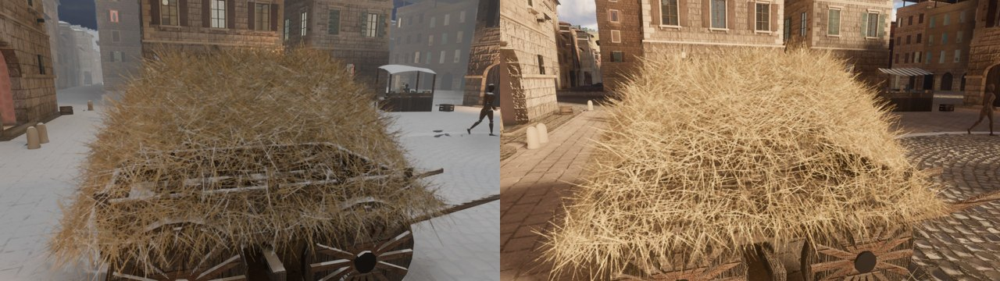

# FellowEngine — milestone 215 report (the hay's straws stir in the wind)

Status: **FINAL** (2026-11-26). Branch `fellow/geometry`. GPU: the RTX filmed the cart with the camera still in a
blizzard and on the fair evening, before and after (jobs f605, f608). Decision 0357.

## 0. Result

Milestone 210's open point: the cart's 26,000 straws did not move — and since milestone 211 a blizzard blows across the
square at 14 m/s.

* The straws sway in the scene's wind — FellowEngine's material wind (its gusts too), in the vertex shader: those
  standing out of the heap or hanging over the boards most, those lying in it hardly, each from its foot.
* Between two frames of the still camera, 13 % of the heap's pixels change by more than 12 levels (1.3 % before: the
  falling snow).

## 1. Open

* The straws stay on the cart: a gust does not lift them off (the leap of faith's burst does).
* No snow settles on the straws (thin, steep blades: the snow cover takes the faces turned up).
