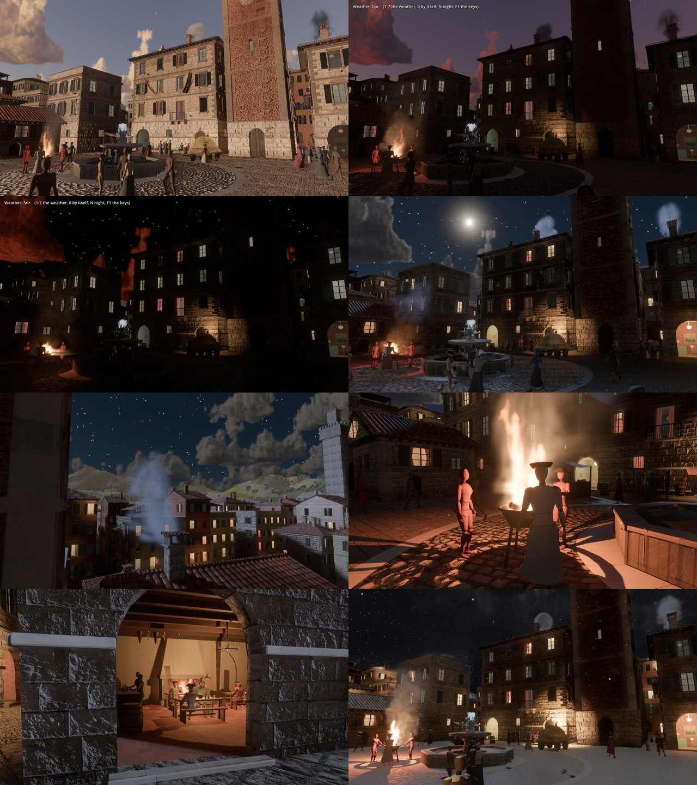

# FellowEngine — milestone 216 report (night falls on the square)

Status: **FINAL** (2026-11-26). Branch `fellow/geometry`. GPU: the RTX filmed night falling from the square and over the
roofs, and the square, a chimney, the brazier, the osteria, snow and a storm at night (jobs f606-f610). Decision 0358.

## 0. Result

Milestone 188's open point: the rooms behind the windows never lit, no night on the square.

* **N**: over 20 s the sun sets — slowly through the horizon, the sky through its sunset, a pink-violet dusk and its
  twilight (FellowEngine's atmosphere), the clouds still lit red overhead after the sky has gone dark — then the moon
  rises over the roofs: a pale blue light, sharp shadows, the sky dark blue with its stars out.
* **The windows light up**: the rooms behind half of them have their lamps on; the square's lamps, the brazier and the
  osteria glow in the dark; the eye adapts. The weather keys go on working at night (snow, a storm's lightning).
* N again: the day comes back. The demo's path is unchanged.

## 1. Open

* The moon is the sun's light turned blue, from 28° up: no phases, its disk a soft bright circle.
* The people and the market stalls keep the day's routine at night.
