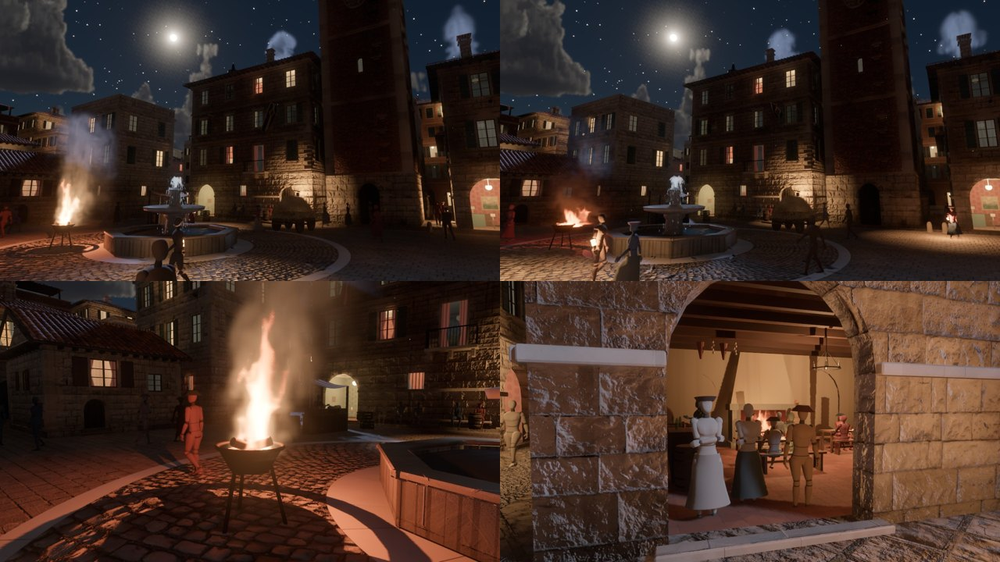

# FellowEngine — milestone 218 report (the square's people at night)

Status: **FINAL** (2026-11-26). Branch `fellow/geometry`. GPU: the RTX filmed the square, the brazier and the osteria's
door at night (job f614). Decision 0360.

## 0. Result

* At night (N) the square's groups go home by the streets or into the osteria for a glass ("Buonanotte!", "A domani!"),
  and come back in the morning; the stall keepers stay.
* Every third walker carries a lantern, its warm light swinging with the arm across the dark square.
* They talk of the night: the moon over the tower, the osteria still open, the watch.

## 1. Open

* The walkers keep their day's routes at night.
* SDFGI takes a few seconds to darken when the night comes at once (`--night=1`); with N, over 20 s, it keeps up.
