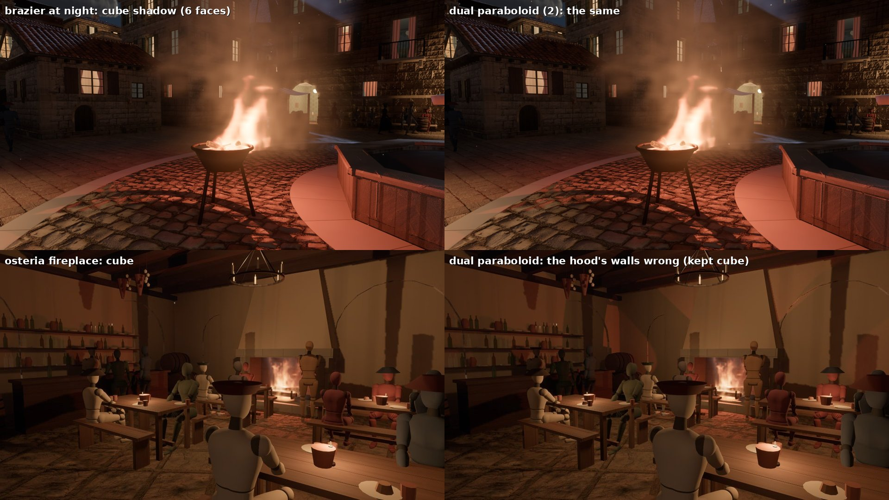

# FellowEngine — milestone 219 report (the brazier's shadow a dual paraboloid's)

Status: **FINAL** (2026-11-26). Branch `fellow/geometry`. GPU: the RTX measured the rooftops with each shadowed omni
light cube or dual paraboloid and filmed the brazier at night and the osteria (jobs f616-f618). Decision 0361.

## 0. Result

* The square's brazier lights the square with a **dual paraboloid shadow** (two renders a frame, not a cube's six):
  0.4-0.6 ms less of the GPU's frame and 0.2-0.5 ms of the render thread in the square at 1080p, the brazier at night
  the same picture.
* The osteria's fireplace keeps its cube: under its hood the dual paraboloid lit the hood's walls wrongly (it was
  1.2 ms cheaper there).

## 1. Open

* The osteria's two shadowed lights (its fireplace and chandelier) still take 1.9 ms of the GPU inside it.
