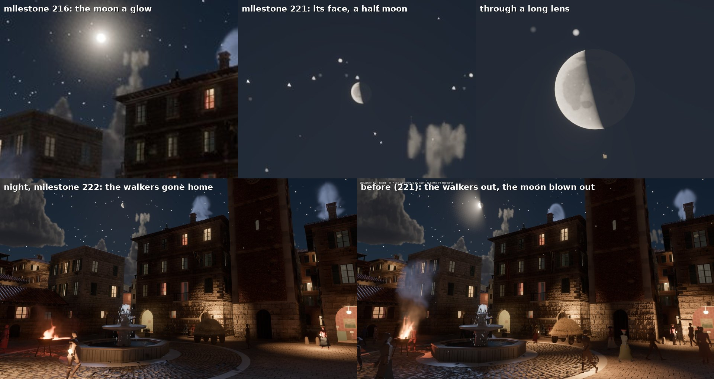

# FellowEngine — milestone 221 report (the moon's face)

Status: **FINAL** (2026-11-26). Branch `fellow/geometry`. GPU: the RTX filmed the moon through a long lens and from the
square at night (jobs f620, f621). Decision 0363.

## 0. Result

Milestone 216's open point: the moon was the sun's disk turned blue, a white glow.

* The moon has a face: a **half moon** lit from where the sun set (its phase and terminator from the sun's direction
  under the horizon), its seas and bright craters where they are, earthshine faint on its dark side, its edge clean.
* It is as bright as the night's exposure shows it: the brightest thing in the sky, its face readable — no longer blown
  out into a glow.
* The stars stay points through a long lens (`climb_look.gd --view=moon`).

## 1. Open

* The moon's phase is fixed by where the sun set (a half moon); no calendar.
