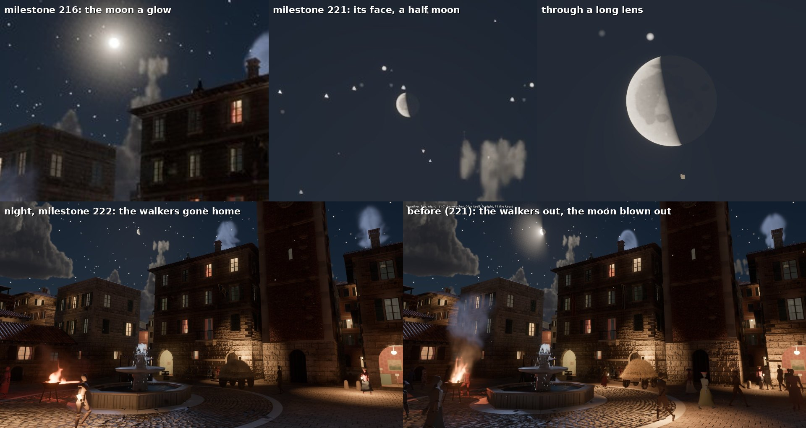

# FellowEngine — milestone 222 report (the walkers go home at night)

Status: **FINAL** (2026-11-26). Branch `fellow/geometry`. GPU: the RTX filmed the square at night (job f621). Decision
0364.

## 0. Result

Milestone 218's open point: the walkers kept their day's routes at night.

* At night most walkers without a lantern go home down the nearest street ("Buonanotte!"); the lantern carriers stay.
  With the groups gone too, 28 of the square's 63 people are away at night (14 before).
* By day they come back out of the streets to their ways.

## 1. Open

* The stalls stay open at night.
