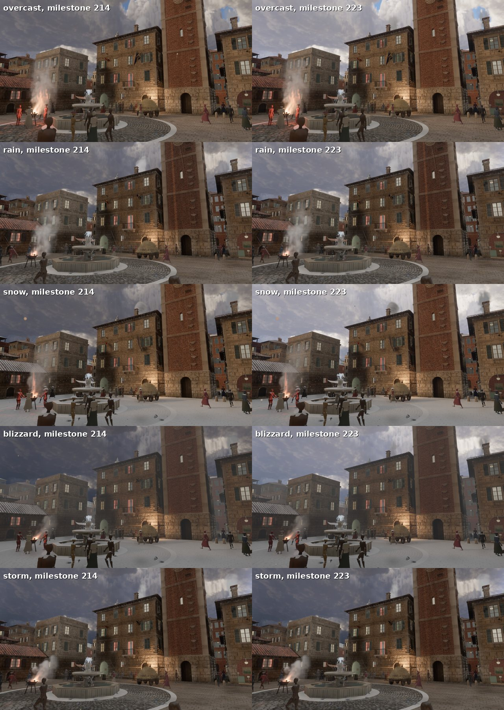

# FellowEngine — milestone 223 report (each weather's sky)

Status: **FINAL** (2026-11-26). Branch `fellow/geometry`. GPU: the RTX filmed the square under each weather before
and after, and snow turning to a storm and to overcast (jobs f622, f623). Decision 0365.

## 0. Result

Milestone 214's open point: under snow the square's sky was a storm's, dark grey over the white square.

* Each weather lights its clouds as its own: snow a bright white-grey sky, a blizzard a lighter grey one, overcast and
  rain grey, a storm dark as before — eased as the weather turns.

## 1. Open

* Under a residual sun (5 % in the snow) the bell tower's shadow still shows on the houses.
