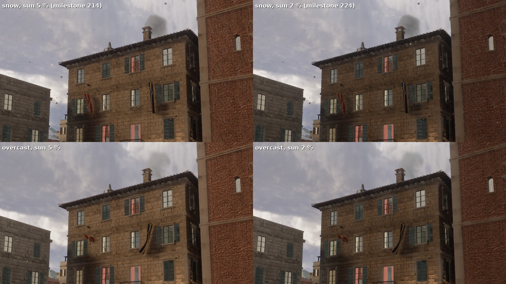

# FellowEngine — milestone 224 report (less sun under a closed deck)

Status: **FINAL** (2026-11-26). Branch `fellow/geometry`. GPU: the RTX filmed the square under snow, overcast and a
storm with the sun's share from 5 to 0.5 % (job f624). Decision 0366.

## 0. Result

* Under snow and overcast the houses no longer take the golden sun through a closed deck: 2 % of it (5 % before), the
  light on the square the sky's — even, grey; the tower's shadow on PalazzoOcra's front gone (its lit and shaded parts
  1.17 to 1 apart; 1.32 before).

## 1. Open

* Rain's and the blizzard's darkening with the less sun estimated, not measured.
