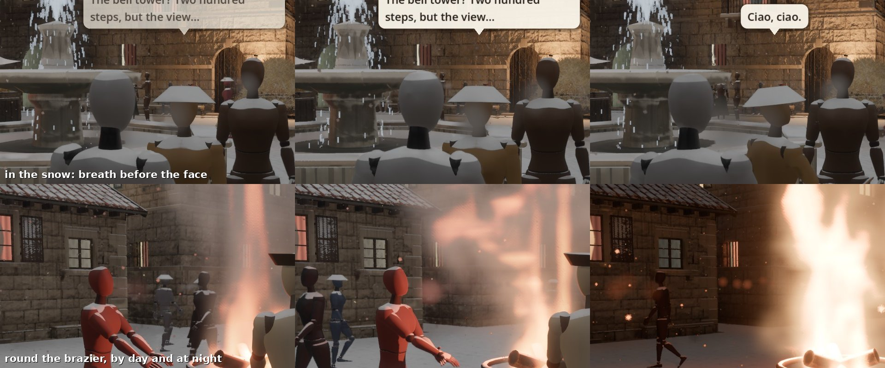

# FellowEngine — milestone 225 report (breath in the cold)

Status: **FINAL** (2026-11-26). Branch `fellow/geometry`. GPU: the RTX filmed a talk and the brazier's ring in the snow
and measured the frame with and without (jobs f625, f626). Decision 0367.

## 0. Result

* In the snow and the blizzard everyone near the camera — and the player — breathes out a small puff of mist every few
  seconds, each at its own pace, left in the air as they walk on, lit by the brazier or the grey sky. Up to 0.1 ms.

## 1. Open

* The puffs come at a steady pace: not faster when the people talk or hurry.
