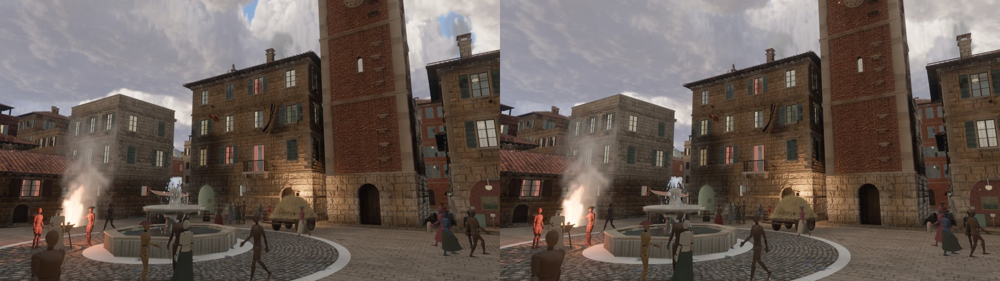

# FellowEngine — milestone 226 report (an overcast sky closed; the breath's pace)

Status: **FINAL** (2026-11-26). Branch `fellow/geometry`. GPU: the RTX filmed the overcast square and measured its
darkness with the eye not adapting (job f628). Decision 0368.

## 0. Result

* The rooftops' overcast sky is closed: no blue between the clouds (coverage 0.97, the preset's 0.9 before).
* The breath in the cold comes quicker as people walk, hurry home or talk.

