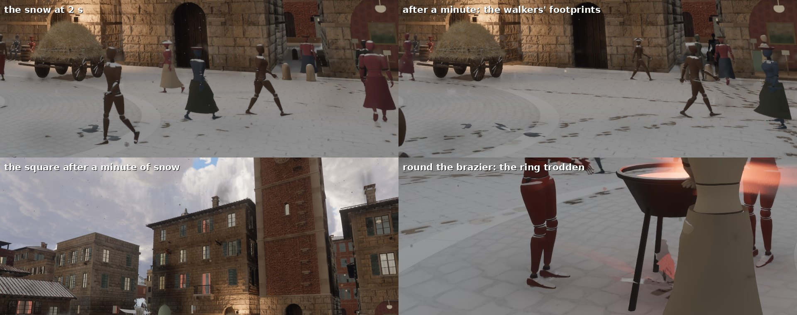

# FellowEngine — milestone 227 report (footprints in the snow)

Status: **FINAL** (2026-11-26). Branch `fellow/geometry`. GPU: the RTX filmed a minute of snow on the square and
measured the frame with and without (jobs f630-f632). Decision 0369.

## 0. Result

* In the rooftops' snow everyone leaves footprints — the 63 people and the player: after a minute the walkers' ways are
  lines of prints down to the cobbles, the brazier's ring trodden round; the falling snow fills them back slowly. No
  cost measurable.

