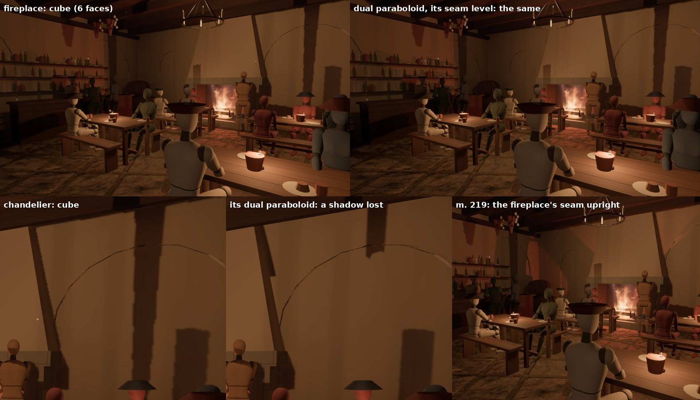

# FellowEngine — milestone 228 report (the osteria fireplace's shadow, its seam level)

Status: **FINAL** (2026-11-26). Branch `fellow/geometry`. GPU: the RTX filmed and measured the osteria with its lights'
shadows dual paraboloid, their seams level, against the cubes (jobs f633, f635). Decision 0370.

## 0. Result

Milestone 219's open point: the osteria's two shadowed lights took 1.9 ms; its fireplace's dual paraboloid shadow
had drawn a dark wedge beside the hood (the seam upright, through the hood's sides).

* The fireplace's light casts a dual paraboloid shadow with its **seam level** with the fire: the room as with the
  cube's six faces (1 % of the pixels differing, the flames' flicker), 0.4-0.5 ms of GPU and of the render thread less
  inside, about 1 ms at its door (the brazier's and the fireplace's lights both).
* The chandelier keeps its cube (dual paraboloid, a wall's long shadow at its height was lost).

