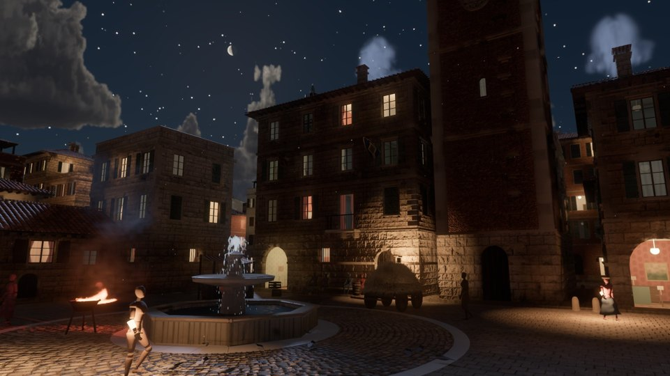

# FellowEngine — milestone 229 report (the stall keepers go home at night)

Status: **FINAL** (2026-11-26). Branch `fellow/geometry`. GPU: the RTX filmed the square at night (job f635).
Decision 0371.

## 0. Result

Milestone 222's open point: the stalls stayed kept at night. Now the keepers close up and go home (in the rain they
still huddle under their awnings) and come back by day: the square at night is its lantern carriers', the osteria's
and the brazier's.

