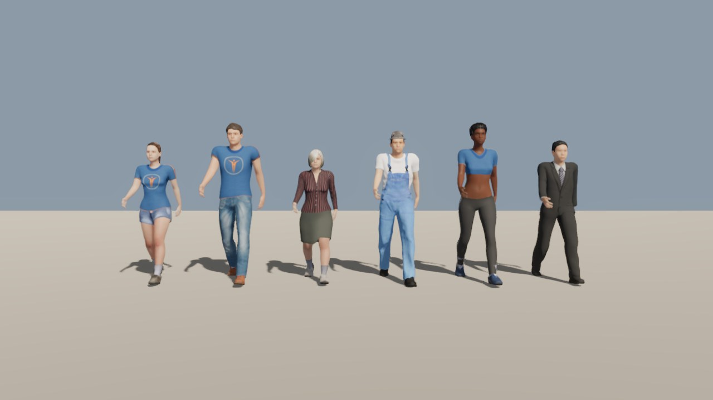

# FellowEngine — milestone 232 report (people instead of mannequins)

Status: **FINAL** (2026-11-26). Branch `fellow/geometry`. Decision 0374. No GPU work (the owner's request): checked on
lavapipe.

## 0. Result

The second of the gaps named after milestone 230, and the largest one seen: the rooftops' people were wooden
mannequins. Now they are people — six MakeHuman bodies of different ages, builds and origins, with their skins, hair
and clothes, tinted apart so that 63 of them are not twins — walking, talking, sitting and reacting exactly as the
mannequins did, because the mannequins are still there underneath, driving them.

## 1. How

* `tools/fellow_characters/make_characters.py`: Blender 5.3 as a Python module and MPFB 2 from its source, in a
  Blender profile of its own (nothing installed on the owner's laptop); MakeHuman's system assets pack (CC0). Six
  people in 32 s: the macros applied, the faces under the clothes removed, the bones renamed to Godot's humanoid
  profile, textures sized for a game and encoded again (Godot refuses Blender's JPEGs). 1.7-2.2 MB each, all CC0.
* `showcase/scripts/fellow_person.gd`: the mannequin's mesh hidden, a `RetargetModifier3D` on its skeleton driving the
  person's; the person's limbs' rests turned to the mannequin's T-pose first (from MPFB's A-pose the arms crossed over
  the body); its own height kept; skin with subsurface scattering, hair and lashes cut by their alpha.
* The crowd (`rooftops_crowd.gd`) wears them; breath and footprints on the person's head and feet; `--people=0` for the
  mannequins. `tools/person_look.gd`: one person or the cast, a clip, from the front, the side, the face.

## 2. Open

* The GPU's time with 63 people (about 2 million triangles more before LODs) on the RTX.
* The player's own person; period clothes from MakeHuman's CC0 packs; faces (the CC0 visemes) for FellowFaceAnimator;
  the skin's detail close up (normal and roughness maps, the eyes).
