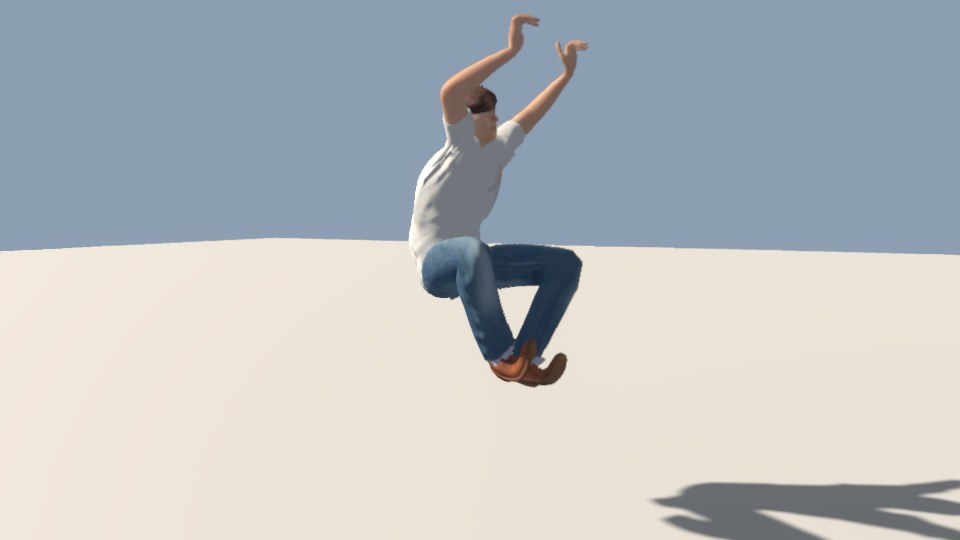

# FellowEngine — milestone 233 report (the player a person)

Status: **FINAL** (2026-11-26). Branch `fellow/geometry`. Decision 0375. No GPU work: checked on lavapipe.

## 0. Result

The player is a person too: Luca, worn over the player's mannequin like the crowd's people (milestone 232), scaled to
its hips. Because the player's traversal puts the mannequin's hands on stone and its feet on walls, a two-bone IK after
the retargeting takes the person's hands and feet to the mannequin's (a limb stretched up to 10 % where the mannequin's
long arms reach farther): over the player's 54 clips the worst gap fell from 15.9 cm to 1.6 cm (one jump), 0.01 cm in
the others.

## 1. What was learnt

* A modifier on the person's own skeleton runs before the RetargetModifier3D hands the pose over (the person's skeleton
  updates first) and is overwritten; BoneAttachment3Ds on the mannequin follow its pose before its modifiers. The IK is
  a modifier on the mannequin's skeleton right after the retargeting, writing into the person's skeleton.

## 2. Open

* The player on the walls, seen: the rooftops outgrow lavapipe's 7 GB here — on the RTX when allowed.
