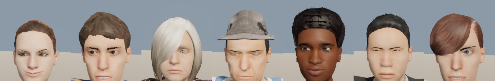

# FellowEngine — milestone 235 report (eyes and moods)

Status: **FINAL** (2026-11-26). Branch `fellow/geometry`. Decision 0377. No GPU work: checked on lavapipe.

## 0. Result

The rooftops' people look with their eyes: when the player comes near, their eyes go to the player first and the
head follows; without anyone to look at, the eyes rest ahead with small saccades. Each eye stays within 1.4° of its
target while the head moves with the clip. Their faces show moods: a smile when the player talks to them (a frown if
the player knocked them down before), surprise when run into or when they see the player up on a wall, a grimace of
pain on the ground, and a cross face for a few seconds after getting up. The irises have their own colours now (the
pack's default was a red-brown for everyone).

## 1. Changes

* `tools/fellow_characters/make_characters.py`: `eye_bones` (Godot's `LeftEye`/`RightEye` under the head, each eyeball
  weighted to its own) and `eye_colour` (`people.json`'s `eye_colour`; `darkbrown` made from the pack's brown). All
  seven people regenerated (24.5 MB).
* `showcase/scripts/fellow_person_eyes.gd` (new): the eyes turned by FellowFaceAnimator's gaze, measured in the head
  (the face told the head's turn through `set_head_turn`), from a modifier on the mannequin's skeleton after the
  hand-over.
* `showcase/scripts/fellow_person.gd`: the gaze on when the rig has eye bones; a "pain" expression.
* `showcase/scripts/rooftops_crowd.gd`: `_mood` and its hooks; the face animator's target on the player while they
  look; the face animator under its own key (`face_anim`).
* `showcase/tools/person_look.gd`: `--look=1` (a target circling before the face), `--mood=name[:weight]`.

## 2. Fixed

* Milestone 234 put the face animator under the person's `"face"` key, which held the way it faces at its place: a
  person walking back to its place after a reaction failed at `float(p.face)` every frame and never settled. Checked:
  knocked down, up again, back at its place and settled, no error.

## 3. Measurements (lavapipe, editor build)

| | |
|---|---|
| eye aim error, target sweeping ±20° / ±12° at 1 m, head turning up to 15° | ≤ 1.34° (the easing's lag) |
| the same with the head's turn not reaching the face | up to 16° (the error followed the head) |
| eyes modifier | 6.8 µs a person a frame, only for faces processed (within 25 m) |

## 4. Open

* The hair cards' dark fringes (visible on Amara's afro): alpha scissor over mipmaps — alpha to coverage or a
  mip-aware cut.
* The player's own eyes on the person they talk to; idle glances between passers-by.
* On the RTX when the GPU is allowed: the crowd's cost with faces and eyes, the shadows' cache (milestone 231).
