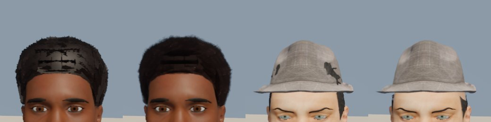

# FellowEngine — milestone 236 report (hair)

Status: **FINAL** (2026-11-26). Branch `fellow/geometry`. Decision 0378. No GPU work: checked on lavapipe.

## 0. Result

The people's hair has soft edges and no longer shines like plastic, and Aldo's fedora is clean: the black patches on
its crown were his hair coming through it.

## 1. Changes

* `showcase/scripts/fellow_person.gd`: the hair (not the brows and lashes) drawn with an opaque pre-pass and blended
  at its edges, roughness 0.8, specular 0.25 (`hair_mode`: 0 for the old cut hair).
* `tools/fellow_characters/make_characters.py`: `trim_under_hat` — the hair's faces above a hat's underside removed.
  `showcase/people/aldo.glb` regenerated (the only person with a hat).
* `showcase/tools/person_look.gd`: `--hair=0|1`, `--hide=<mesh name part>`.

## 2. Open

* A few darker bands in the afro's own texture remain.
* The hair in the transparent pass (drawn twice): its cost with 63 people on the RTX.
